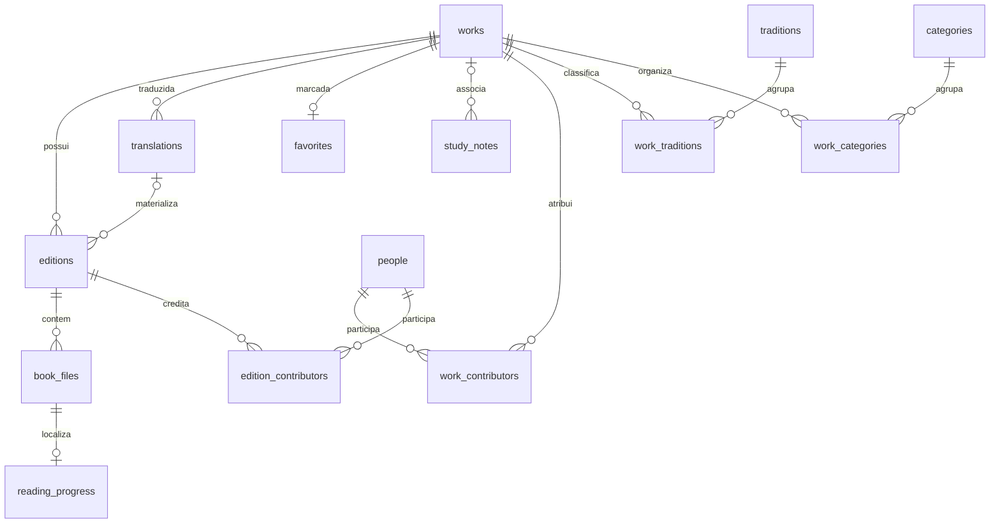

# Arquitetura — fase 1

MVVM com Repository e injeção manual de dependências em `AppContainer`. `MainActivity` apenas cria o ViewModel e apresenta Compose. `SophiaViewModel` combina Flows de Room/DataStore em StateFlow; Compose recolhe-os com ciclo de vida. Coroutines executam operações locais sem bloquear a interface. Estados de carregamento, erro com repetição e ausência de dados são explícitos.

`domain` não depende de Android; `data` implementa os seus contratos. `app` depende de ambos e contém componentes reutilizáveis, navegação entre cinco áreas e diálogos de detalhes/notas. Os filtros, área atual, obra selecionada e rascunho usam SavedStateHandle; favoritos e notas persistem em Room. Rascunhos não equivalem a notas guardadas: a restauração depende do estado Android disponível e não substitui Guardar.

## Modelo normalizado

Uma obra não é uma edição. Traduções têm entidade própria; a chave estrangeira composta impede associar uma tradução de outra obra a uma edição. Tradutores e editores científicos pertencem aos colaboradores da edição. Um ficheiro pertence a uma edição, com URI, tipo e direitos por verificar; o progresso pertence a esse ficheiro. Não existem ficheiros nem progresso de demonstração.

Notas podem não ter obra associada; apagar futuramente uma obra conserva as notas e remove essa associação (`SET_NULL`). Favoritos e ligações de classificação usam chaves e integridade referencial. Não existe operação UI de eliminação do catálogo nesta fase.

## Persistência e migrações

Room, esquema inicial versão 1, exportado pelo KSP para `data/schemas`. `DatabaseMigrations.ALL` está vazio porque não existe versão anterior. Não há migrações fictícias nem `fallbackToDestructiveMigration`. Alterações futuras do esquema exigem incremento da versão, migração explícita e teste de atualização com os esquemas guardados. A versão atual tem testes de integridade, reabertura e persistência; estes não são testes de migração entre versões.

O catálogo é inserido transacionalmente uma vez, com marcador de versão e `IGNORE`; não substitui favoritos/notas em arranques sucessivos. Preferências simples ficam em DataStore, separado da biblioteca.

## Evolução prevista, não implementada

Um leitor Readium e importação SAF poderão consumir edições/ficheiros e gravar localizadores no progresso. Uma futura pesquisa FTS ou motor RAG deve ser um serviço próprio, mantendo fontes e citações verificáveis. Fornecedores IA, comparação de ensinamentos e backup/restauro exigirão contratos e implementação nas respetivas fases. Não há dependências dessas funcionalidades nesta versão.
